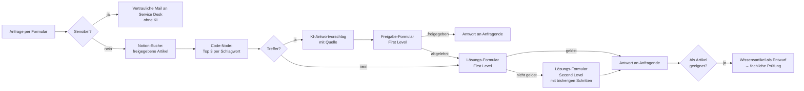
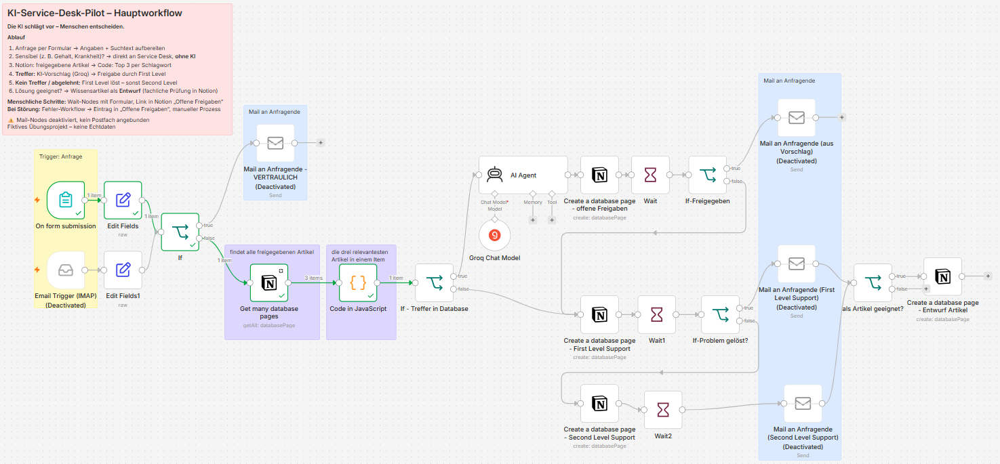
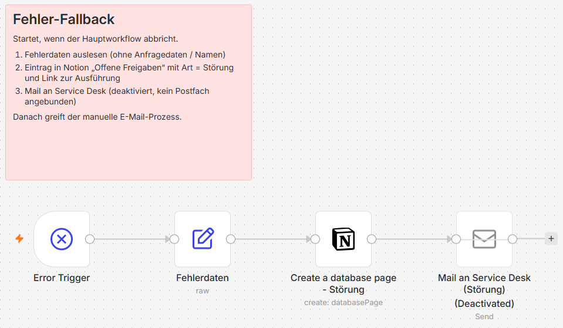

# KI-Assistent für den IT-Service-Desk – n8n-Pilot mit Human-in-the-Loop

> Konzeption, Umsetzung und Test eines KI-Assistenten für den IT-Service-Desk – vom Problem Statement über Risikoanalyse und Human-in-the-Loop-Konzept bis zum funktionsfähigen n8n-Workflow.

Ein n8n-Workflow, der IT-Anfragen über ein Formular aufnimmt, in einer geprüften Notion-Wissensdatenbank nach Lösungen sucht und per KI einen Antwortvorschlag formuliert. **Keine Antwort verlässt das System ohne menschliche Freigabe.** Findet das System keine passende Lösung, übernimmt der First- bzw. Second-Level-Support. Neue Lösungen fließen nach fachlicher Prüfung als Wissensartikel zurück.

**Leitgedanke:** *Die KI schlägt vor – Menschen entscheiden.*

## Meine Rolle

Projektleitung und technische Umsetzung in einer Hand:

- **Projektvorgehen:** Problem Statement und SMART-Ziel, Optionsvergleich, Compliance-Gate und KI-Risikoklassifizierung, Stakeholder- und RACI-Analyse, Risikoregister, Change-Management
- **Workflow selbst gebaut und getestet:** n8n mit Formularen, Notion-Wissensdatenbank, KI-Agent (Groq), menschlichem Freigabeprozess und separatem Fehler-Workflow
- **Qualitätssicherung:** Testprotokoll mit sechs Testfällen, Code-Review, Fehlerbehebung und Nachtest
- **Verantwortungsvoller KI-Einsatz:** Schutz sensibler Daten, keine ungeprüften KI-Antworten, Mitbestimmung und Datenschutz von Anfang an mitgedacht

## Kontext

Entstanden als Projekt im Rahmen einer Weiterbildung zur verantwortungsvollen KI-Einführung im Unternehmen. Unternehmen (*Bergmann Industriekomponenten GmbH*), Personen und Kennzahlen sind **fiktiv**; der Workflow ist real gebaut und getestet.

---

## Inhalt

- [Ausgangslage](#ausgangslage)
- [Ziel](#ziel)
- [Lösung](#lösung)
- [Ablauf](#ablauf)
- [Technik](#technik)
- [Repository-Struktur](#repository-struktur)
- [Einrichtung](#einrichtung)
- [Schutz- und Kontrollmaßnahmen](#schutz--und-kontrollmaßnahmen)
- [Ergebnisse des Pilots](#ergebnisse-des-pilots)
- [Offene Punkte und Grenzen](#offene-punkte-und-grenzen)
- [Projektvorgehen](#projektvorgehen)
- [Hinweise](#hinweise)

---

## Ausgangslage

Der IT-Service-Desk eines mittelständischen Industrieunternehmens (620 Beschäftigte, Schichtbetrieb) ist überlastet:

| Kennzahl | Wert |
|---|---|
| Anfragen pro Tag | 145–210 für 8 Personen |
| Erste Reaktion (Median) | 3 h 20 min |
| Anfragen ohne Gerät oder Standort | 31 % |
| Mehrfache Weitergabe zwischen Teams | 24 % |
| Suche nach einem Wissensartikel | 4,5 Minuten |
| Wiedereröffnungsquote | 11 % |

Folge: Bei Störungen in der Produktion stehen Maschinen länger still.

## Ziel

- Erste Reaktion **unter 45 Minuten** (Vorgabe der Führungskoalition; ursprüngliche Projektannahme: 1 h 30 min)
- Keine KI-Antwort ohne menschliche Prüfung
- Keine sensiblen Tickets (z. B. HR) im KI-Pfad
- Qualität halten: Wiedereröffnung ≤ 9 %

Pilotrahmen: 8 Wochen, 8 Service-Desk-Beschäftigte, ca. 80 Anfragende, 5 Kategorien (Passwort-Selbsthilfe, Standardsoftware, M365, Drucker/Scanner, How-to).

## Lösung

Aus fünf Optionen (u. a. zusätzliche Stellen, reines Portal, reiner KI-Assistent) wurde **Option E** gewählt: *verbessertes Formular + Regeln + begrenzter KI-Assistent*. Sie löst das Problem unvollständiger Anfragen und lässt sich schrittweise einführen.

## Ablauf





*Der Hauptworkflow in n8n. Die Mail-Nodes sind deaktiviert und ohne angebundenes Postfach.*

Menschliche Schritte laufen über **Wait-Nodes mit Formular**. Den Link zum jeweiligen Formular findet das Support-Team in der Notion-Liste **„Offene Freigaben“** – so kommt der Ablauf weitgehend ohne E-Mail aus.

### Fehler-Workflow

Bricht der Hauptworkflow ab, startet ein separater **Fehler-Workflow** (Error Trigger). Er liest nur die technischen Fehlerdaten aus – keine Anfragedaten, keine Namen – und legt in „Offene Freigaben“ einen Eintrag mit **Art = Störung**, Ticket-ID, Fehlermeldung und Link zur fehlgeschlagenen Ausführung an. Danach greift der bisherige manuelle E-Mail-Prozess.



**Stand der Umsetzung:** Hauptworkflow und Fehler-Workflow sind gebaut und getestet. Die **Mail-Nodes** (Antwort an Anfragende, vertrauliche Weiterleitung, Störungsmeldung) sind angelegt, aber **deaktiviert und ohne angebundenes Postfach** – im Pilot wurde kein Mailversand getestet.

## Technik

| Baustein | Aufgabe |
|---|---|
| [n8n](https://n8n.io) | Steuert den gesamten Ablauf (Form Trigger, IF, Code, Wait, AI Agent, Notion; Send Email angelegt, deaktiviert) |
| Notion | Wissensdatenbank (Artikel mit Status, Prüfdatum, Schlagwörtern) und Liste „Offene Freigaben“ |
| KI-Sprachmodell (Groq Chat Model) | Formuliert den Antwortvorschlag – ausschließlich auf Basis der gefundenen Artikel |
| n8n-Formulare | Anfrage, Freigabe, Lösung First Level, Lösung Second Level |
| E-Mail (SMTP) | Vorgesehen für Antwort an Anfragende, vertrauliche Weiterleitung und Störungsmeldung – im Pilot deaktiviert, kein Postfach angebunden |
| n8n Error Trigger | Fehler-Workflow: meldet technische Störungen in „Offene Freigaben“ |

## Repository-Struktur

```
├── README.md
├── LICENSE
├── workflow/
│   ├── helpdesk-pilot.json          # n8n-Hauptworkflow (Export, ohne Zugangsdaten)
│   └── fehler-fallback.json         # n8n-Fehler-Workflow
├── notion/
│   ├── wissensdatenbank-testeintraege.csv
│   └── datenbank-schema.md          # Spalten der Wissensdatenbank und von „Offene Freigaben“
├── docs/
│   ├── abschlusspraesentation.pdf
│   ├── testprotokoll.md
│   └── uebergabe-n8n-pilot.md
└── images/
    ├── workflow-n8n.png
    └── fehler-workflow-n8n.png
```

## Einrichtung

1. **n8n** starten (z. B. lokal per Docker oder n8n Cloud).
2. Workflows importieren: *Workflows → Import from File* → `workflow/helpdesk-pilot.json` und `workflow/fehler-fallback.json`.
3. **Zugangsdaten anlegen** (werden nicht mitgeliefert):
   - Notion-Integration (notion.so/my-integrations) und mit beiden Datenbanken verbinden
   - API-Key für das Sprachmodell (z. B. Groq)
   - optional: SMTP-Zugang für den Mailversand – danach die deaktivierten Mail-Nodes aktivieren und das Postfach eintragen
4. **Notion-Datenbanken anlegen** (vollständiges Schema: [`notion/datenbank-schema.md`](notion/datenbank-schema.md))
   - *Wissensdatenbank*: u. a. Titel, Kategorie, Status (Text: Entwurf / freigegeben), Schlagwörter, Fehlerbild, Lösung (Schritte), Eskalation wenn, Prüfdatum, Ursprungsticket – Testdaten: `notion/wissensdatenbank-testeintraege.csv`
   - *Offene Freigaben*: Ticket ID (Titel), Status (Auswahl), Art (Auswahl), Problem (Text), Formular-Link (URL), erstellt am (Datum)
   - In den Notion-Nodes die Platzhalter `NOTION_DATENBANK_ID_WISSENSDATENBANK` und `NOTION_DATENBANK_ID_OFFENE_FREIGABEN` durch die eigenen Datenbanken ersetzen und die Zugangsdaten auswählen
5. Fehler-Workflow veröffentlichen und im Hauptworkflow unter *Settings → Error Workflow* auswählen.
6. Hauptworkflow veröffentlichen und über die **Production-URL** des Formulars testen. Der Fehler-Workflow startet nur bei Produktions-Ausführungen, nicht bei Tests im Editor.

> **Hinweis:** Formular-Links von Wait-Nodes funktionieren nur, solange die jeweilige Ausführung wartet. Für den Einsatz im Firmennetz muss n8n unter einer erreichbaren Adresse laufen (`WEBHOOK_URL`).

## Schutz- und Kontrollmaßnahmen

**Technisch**
- Filter für sensible Inhalte (z. B. Gehalt, Krankheit, Kündigung) – solche Anfragen gehen ohne KI an den Service Desk
- Nur freigegebene, geprüfte Artikel werden genutzt
- Die KI hat keine Systemrechte, sie erstellt nur Vorschläge
- Fehler-Workflow meldet technische Störungen; danach gilt der bisherige manuelle E-Mail-Prozess

**Organisatorisch**
- Pflicht zur menschlichen Freigabe jeder Antwort – Ablehnen ohne Begründungspflicht
- Abbruchkriterien und Eskalationsweg (≤ 1 h Teamleitung, ≤ 4 h IT-Leitung, ≤ 1 Arbeitstag Steering)
- Modellwechsel nur nach Change-Gate mit Regressionstest

**Mitbestimmung und Datenschutz**
- Keine Auswertung je Person, nur Team-Kennzahlen
- Pseudonymisierung und Zweckbindung, Pilotvereinbarung mit dem Betriebsrat
- Einordnung nach KI-Verordnung: begrenztes Risiko

## Ergebnisse des Pilots

*Fiktive Ergebnisse nach acht Pilotwochen (Fallinformation der Weiterbildung):*

| Kennzahl | Vorher | Nach 8 Wochen | Ziel | Bewertung |
|---|---|---|---|---|
| Erste Reaktion (Median) | 3 h 20 min | 38 Min. | < 45 Min. | ✓ erreicht |
| Aktive Bearbeitungszeit | 14 Min. | 8,5 Min. | ≤ 8 Min. | ◐ knapp verfehlt |
| Wiedereröffnung | 11 % | 9 % | ≤ 9 % | ✓ erreicht |
| Dokumentation vollständig | 64 % | 94 % | ≥ 90 % | ✓ erreicht |
| Richtig eingestuft | 82 % | 93 % | ≥ 92 % | ✓ erreicht |
| Fachlich korrekte Treffer | – | 91 % | ≥ 90 % | ✓ erreicht |
| Ungeprüft versandte Antworten | – | 0 | 0 | ✓ Schutzgrenze gehalten |
| Sensible Tickets von der KI verarbeitet | – | 0 (2 abgefangen) | 0 | ✓ Schutzgrenze gehalten |

Details: [Abschlusspräsentation (PDF)](docs/abschlusspraesentation.pdf)

**Empfehlung:** Ausweitung unter Auflagen – Rollout auf das gesamte Service-Desk-Team in den fünf Pilotkategorien; neue Kategorien erst nach bestandenem Test des neuen KI-Modells.

## Offene Punkte und Grenzen

- Angekündigter Modellwechsel des Anbieters – Umstellung nur nach Regressionstest
- Qualitätskennzahlen liegen knapp an der Grenze (kein Puffer)
- 58 % der Anfragen finden keinen passenden Artikel
- 67 % der Vorschläge werden unverändert freigegeben – Automationsbias noch nicht ausgeschlossen
- Die Suche ist eine einfache Schlagwortsuche (keine semantische Suche)
- Mailversand nicht angebunden: Mail-Nodes deaktiviert, kein Postfach konfiguriert
- Die Notion-Suche liest höchstens 5 freigegebene Artikel (Limit im Node „Get many database pages“) – für eine größere Wissensdatenbank auf „Return All“ umstellen
- Mail-Eingang ist nur konzeptionell umgesetzt; Status „erledigt“ in Notion wird manuell gesetzt

## Projektvorgehen

Problem Statement und SMART-Ziel → Optionsvergleich → Compliance-Gate und KI-Risikoklassifizierung → Stakeholder- und RACI-Analyse → Risikoregister mit Maßnahmen → Human-in-the-Loop-Konzept → Bau und Test in n8n (6 Testfälle, 3 Fehler behoben, Nachtest mit 4 Fällen – siehe [Testprotokoll](docs/testprotokoll.md)) → Change-Management (SCARF, Kotter, Kommunikationsplan, Schulungen) → Pilotauswertung mit PDCA → Abschlussentscheidung.

## Hinweise

- Lern- und Demonstrationsprojekt, **nicht für den Produktiveinsatz** ohne eigene Prüfung von Datenschutz, Informationssicherheit und Mitbestimmung.
- Alle Namen, Unternehmensdaten und Kennzahlen sind fiktiv.
- Fallinformationen stammen aus den Unterlagen der Weiterbildung und werden hier nur zusammengefasst.

## Lizenz

Code und Workflows: MIT-Lizenz (siehe [`LICENSE`](LICENSE)). Dokumentation (Texte, Präsentation, Bilder): [CC BY 4.0](https://creativecommons.org/licenses/by/4.0/deed.de).
